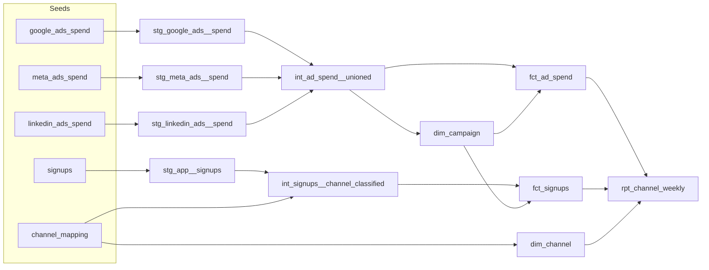

# Paid Media Performance Mart

A dbt + BigQuery project that unifies ad spend from Google Ads, Meta, and LinkedIn with
UTM-attributed signups in a star schema, and reports CAC and ROAS by channel and week.

Data is synthetic (generated by `scripts/generate_seeds.py`), built to mimic real platform
exports: different column names per platform, Google spend in micros, and messy UTMs.

## Architecture



| Layer | Materialization | Purpose |
|---|---|---|
| Staging | view | One model per source: rename, cast, convert units. No joins. |
| Intermediate | view | Union the platforms; classify signups by channel. |
| Marts | table | Star schema plus a reporting model. |

## Star schema

| Model | Grain | Keys |
|---|---|---|
| `dim_channel` | one row per channel | `channel_key` |
| `dim_campaign` | one row per platform campaign | `campaign_key`, FK `channel_key` |
| `fct_ad_spend` | date x campaign | FKs `campaign_key`, `channel_key` |
| `fct_signups` | one row per signup | FKs `channel_key`, `campaign_key` (null for non-paid) |
| `rpt_channel_weekly` | week x channel | spend, signups, revenue, CAC, ROAS |

## Design decisions

- **Surrogate keys** (`dbt_utils.generate_surrogate_key`) so campaign IDs from different
  platforms can never collide, and dims can be rebuilt without breaking facts.
- **Channel classification lives in a mapping seed**, not hard-coded CASE logic, so a new
  UTM variant is a one-row change.
- **UTM cleanup happens in staging** (lowercase, trim, blank to `(none)`) so the mapping join
  is exact.
- **`ad_platform` on signups** lets paid signups join to `dim_campaign` on
  (platform, campaign_id); signups with broken campaign tagging keep their channel but have
  no campaign.

## Tests (24)

- `unique` / `not_null` on every dimension key
- Fact grain: `unique_combination_of_columns(spend_date, campaign_key)`
- `relationships` from every fact and dim foreign key to its parent
- `accepted_values` on channel names
- **Spend reconciliation:** modeled spend must match the sum of the raw platform exports
  within $0.01
- **No unclassified signups:** fails if any UTM combination falls through to `Other`
- No negative spend

## Results (Jul 1 to Sep 30, 2026)

| Channel | Spend | Signups | CAC |
|---|---:|---:|---:|
| Paid Search | $168,847 | 1,502 | $112 |
| Paid Social - Meta | $106,705 | 894 | $119 |
| Paid Social - LinkedIn | $76,058 | 275 | $277 |
| **Blended paid** | **$351,610** | **2,671** | **$132** |

ROAS uses first-month plan revenue only, so it understates lifetime return.

## Run it

```bash
python -m venv dbt-env && source dbt-env/bin/activate
pip install dbt-bigquery
dbt deps
python scripts/generate_seeds.py
dbt build          # seeds, models, and tests
dbt docs generate && dbt docs serve
```

Requires a BigQuery project and a `profiles.yml` using oauth.

## Lineage


