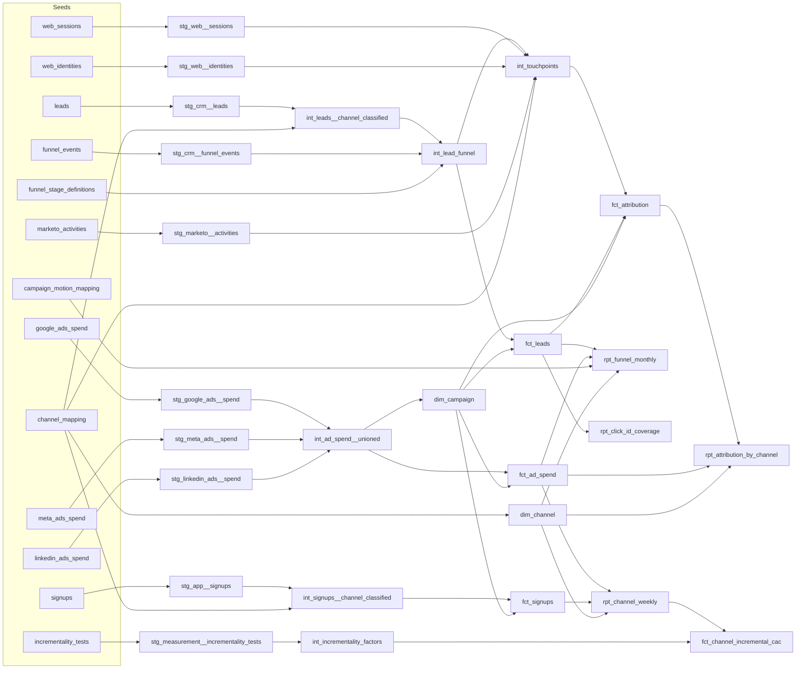
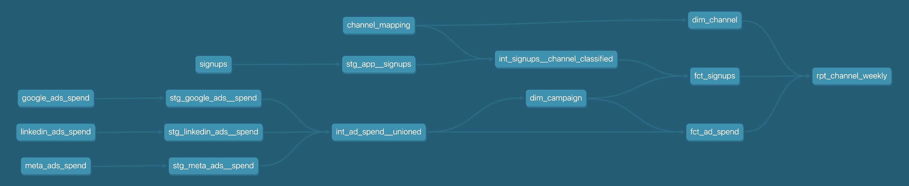

# Paid Media Performance Mart

A dbt + BigQuery project that unifies ad spend from Google Ads, Meta, and LinkedIn with
UTM-attributed signups in a star schema, and reports CAC and ROAS by channel and week.

Data is synthetic (generated by `scripts/generate_seeds.py`), built to mimic real platform
exports: different column names per platform, Google spend in micros, and messy UTMs.

## Architecture



| Layer | Materialization | Purpose |
|---|---|---|
| Staging | view | One model per source: rename, cast, convert units. No joins. |
| Intermediate | view | Union the platforms; classify signups by channel. |
| Marts | table | Star schema plus a reporting model. |

## Star schema

| Model | Grain | Keys |
|---|---|---|
| `dim_channel` | one row per channel | `channel_key` |
| `dim_campaign` | one row per platform campaign | `campaign_key`, FK `channel_key` |
| `fct_ad_spend` | date x campaign | FKs `campaign_key`, `channel_key` |
| `fct_signups` | one row per signup | FKs `channel_key`, `campaign_key` (null for non-paid) |
| `rpt_channel_weekly` | week x channel | spend, signups, revenue, CAC, ROAS |
| `int_incrementality_factors` | one row per test | factor, confidence range, validity window |
| `fct_channel_incremental_cac` | week x paid channel | attributed vs. incremental signups and CAC |
| `fct_leads` | one row per lead | motion, product line, segment, stage timestamps, pipeline, won ARR |
| `rpt_funnel_monthly` | cohort month x product line x motion x channel | spend, stage counts, cost per lead / qualified / won, cost per pipeline dollar |
| `rpt_click_id_coverage` | entry form | share of paid search leads carrying a click ID |
| `fct_attribution` | one row per touch in a lead's journey | credit under first-touch, last-touch, linear, and position-based models |
| `rpt_attribution_by_channel` | attribution model x channel | attributed leads, opportunities, pipeline, won ARR, spend, pipeline per spend dollar |

## Design decisions

- **Surrogate keys** (`dbt_utils.generate_surrogate_key`) so campaign IDs from different
  platforms can never collide, and dims can be rebuilt without breaking facts.
- **Channel classification lives in a mapping seed**, not hard-coded CASE logic, so a new
  UTM variant is a one-row change.
- **UTM cleanup happens in staging** (lowercase, trim, blank to `(none)`) so the mapping join
  is exact.
- **`ad_platform` on signups** lets paid signups join to `dim_campaign` on
  (platform, campaign_id); signups with broken campaign tagging keep their channel but have
  no campaign.

## Tests (89)

- `unique` / `not_null` on every dimension key
- Fact grain: `unique_combination_of_columns(spend_date, campaign_key)`
- `relationships` from every fact and dim foreign key to its parent
- `accepted_values` on channel names
- **Spend reconciliation:** modeled spend must match the sum of the raw platform exports
  within $0.01
- **No unclassified signups:** fails if any UTM combination falls through to `Other`
- No negative spend
- **Funnel:** stages must happen in order, every event must be a valid stage for its lead's motion, and every campaign with spend must map to a motion
- **Attribution:** credits sum to 1 per lead under every model, every lead has exactly one
  lead-creation touch, no credited touch happens after the journey ends, and last-touch
  results reconcile exactly to the lead counts in `fct_leads`
- **Incrementality:** unique test IDs, factors between 0 and 2, test channels must exist in `dim_channel`, and no two tests on a channel can cover the same week

## Incrementality calibration

UTM attribution says which channel touched a signup, not which channel caused it. This layer
adjusts attributed numbers with results from incrementality tests, following the method in the
[measurement playbook](https://github.com/tcmiyamoto/geo-incrementality/blob/main/playbook.md).

1. **Test registry** (`seeds/incrementality_tests.csv`): one row per test, with incremental
   conversions from the test and attributed conversions over the same period.
2. **Factors** (`int_incrementality_factors`): factor = incremental / attributed. Each factor
   applies from its test's end date until the next test on that channel ends.
3. **Incremental CAC** (`fct_channel_incremental_cac`): weekly attributed signups x the factor
   valid that week, with a range from the test's confidence interval. Each row is flagged
   `current`, `stale` (past its re-test date), or `untested` (incremental columns left null,
   not guessed).

| Channel | Spend | Attributed CAC | Incremental CAC | Factor | Status |
|---|---:|---:|---:|---:|---|
| Paid Search | $168,847 | $112 | $173 | 0.65 | current |
| Paid Social - Meta | $106,705 | $119 | $358 | 0.33 | current |
| Paid Social - LinkedIn | $76,058 | $277 | $346 | 0.80 | stale |

On attribution, Meta looks nearly as efficient as Paid Search. On an incremental basis it costs
about twice as much per signup, which points budget toward search and makes LinkedIn's
overdue re-test the next priority.

**Caveats.** Test results are illustrative; the Meta row matches the simulated geo test in
[geo-incrementality](https://github.com/tcmiyamoto/geo-incrementality). In production, the
registry's attributed conversions must use the same attribution source the factor is applied to
(here, UTM last touch), or the factor is miscalibrated.

## B2B funnel: PLG and SLG motions

A lead-level layer for a business with two product lines and two go-to-market motions:

| Product line | Motion | Entry form | Stages |
|---|---|---|---|
| Core | PLG | Free trial | trial started, activated (PQL), converted to paid |
| Core | SLG | Talk to sales | lead, meeting booked, meeting held (SQL), opportunity, won / lost |
| New product | SLG only | Working session | same SLG stages, longer cycle, larger deals |

**Design decisions**

- **One standard funnel across motions.** `funnel_stage_definitions` maps motion-specific
  stages (activated, meeting_held) to standard stages (qualified), so PLG and SLG report side
  by side without hiding that a PQL and an SQL are different things.
- **Spend splits by campaign landing form, not by allocation.** `campaign_motion_mapping`
  assigns each campaign to the motion its landing page feeds, so cost per stage by motion uses
  actual spend. A test fails if any campaign with spend is unmapped.
- **Cohort view.** `rpt_funnel_monthly` counts every stage against the month the lead was
  created, so conversion rates compare like with like. Recent cohorts are still open
  pipeline, especially for the longer new-product cycle.
- **Click ID coverage as a tracking check.** `rpt_click_id_coverage` shows the free trial form
  carries no Google click ID while the sales form does, so trial outcomes can't be sent back to
  the ad platform for bidding. This is a common gap when self-serve and sales-led flows are
  instrumented separately.
- **Portable SQL.** Funnel models use dbt cross-database macros (`dbt.date_trunc`,
  `dbt.datediff`, `dbt.type_string`) so they also run on Snowflake.

**Results (Jul 1 to Sep 30, 2026, cohorts still maturing)**

| Product line | Motion | Spend | Leads | Qualified | Won | Cost per qualified | CAC | Cost per pipeline $ |
|---|---|---:|---:|---:|---:|---:|---:|---:|
| Core | PLG | $215,325 | 3,352 | 1,487 | 474 | $145 | $454 | n/a |
| Core | SLG | $69,825 | 774 | 327 | 30 | $214 | $2,328 | $0.013 |
| New product | SLG | $66,460 | 202 | 97 | 4 | $685 | $16,615 | $0.019 |

Lead counts include organic, direct, referral, and email; spend is paid only. SLG CAC is
overstated until open opportunities close, which is why cost per pipeline dollar is the
better early read for sales-led spend.

Seeds are generated by `scripts/generate_funnel_seeds.py`, which reads the ad spend seeds so
lead volume follows each campaign's daily spend.

## Multi-touch attribution

The funnel layer gives each lead one channel: the UTMs on the form it submitted. B2B buyers
usually touch several channels first, so that view hides what starts a journey. This layer
stitches every touch to a lead and compares four ways of crediting leads, pipeline, and won ARR.

**Sources** (generated by `scripts/generate_touchpoint_seeds.py`)

| Source | Shaped like | What it adds |
|---|---|---|
| `web_sessions` | GA4 session export | Visits with UTMs, including visitors who never convert |
| `web_identities` | Identity stitching | Links a browser's visitor ID to a lead when they submit a form |
| `marketo_activities` | Marketo activity log | Nurture email clicks and webinar attendance |

**Journey rules** (`int_touchpoints`)

- **The CRM form fill is always the lead-creation touch.** Every lead has one, even when web
  tracking was blocked. The web session in the 30 minutes before the form fill is the same
  visit, so it is dropped rather than counted twice.
- **Attribution window:** 90 days before the lead was created, through the opportunity for SLG
  leads that reached one, or through lead creation for everyone else. Post-trial onboarding
  emails and touches after an opportunity opens don't get credit.
- Marketo channels classify through the same `channel_mapping` seed as UTMs, which added an
  `Events` channel for webinars.

**Models** (`fct_attribution`, one row per touch; credits sum to 1 per lead)

| Model | Rule |
|---|---|
| Last touch | 100% to the lead-creation touch. Reconciles exactly to `fct_leads` (tested). |
| First touch | 100% to the earliest touch |
| Linear | Equal share to every touch |
| Position-based | W-shaped for leads with an opportunity (30% first, 30% lead creation, 30% last touch before the opportunity, 10% across the rest); U-shaped (40 / 40 / 20) otherwise |

**Data quality handled in the models**

- 22,758 sessions, 8,667 stitched to a lead. The rest are visitors who never converted or
  visits on a second device that was never identified.
- 341 leads (8%) have no web identity, so their journey is the form fill only.
- 107 duplicate Marketo rows removed (5,357 raw to 5,250).
- UTM casing variants (`LinkedIn`, `Google `) cleaned in staging.
- 5,408 touches outside the attribution window excluded.

**Results: paid channels (Jul 1 to Sep 30, 2026)**

| Channel | Model | Leads | Opps | Pipeline | Share of pipeline | Pipeline per $ |
|---|---|---:|---:|---:|---:|---:|
| Paid Search | Last touch | 1,476 | 50 | $986K | 10.8% | $5.84 |
| | Position-based | 1,173 | 26 | $529K | 5.8% | $3.13 |
| Paid Social - LinkedIn | Last touch | 138 | 29 | $2.26M | 24.7% | $29.73 |
| | First touch | 286 | 68 | $3.26M | 35.6% | $42.84 |
| | Position-based | 210 | 42 | $2.24M | 24.5% | $29.43 |
| Paid Social - Meta | Last touch | 985 | 10 | $462K | 5.1% | $4.33 |
| | Position-based | 1,005 | 8 | $298K | 3.3% | $2.80 |

**What it says**

- **LinkedIn starts more journeys than it gets credit for.** It is the first touch on twice as
  many leads as it converts (286 vs. 138). 70% of LinkedIn-started leads filled in the form
  through another channel, mostly Direct (25%) and Organic Search (18%), so last touch
  undervalues it as a source of new pipeline.
- **Last touch overstates Paid Search for pipeline.** 70% of the opportunities that converted
  through Paid Search started on another channel, usually Referral, LinkedIn, or Organic
  Search, and took 4 to 6 touches. Its pipeline share falls by almost half under the
  position-based model.
- **Linear rewards volume.** It gives Email 25% of pipeline because nurture emails are frequent,
  not because they open opportunities. Position-based (21%) is the better default for budget
  decisions, with first and last touch kept for channel-level questions.
- **Next step:** attribution shows where credit goes, not what would happen without the spend.
  Before moving budget to LinkedIn, rerun its lift test, which is already flagged `stale` in
  the incrementality layer.

**Caveats.** Data is synthetic and built to show these patterns. The 90-day lookback reaches
into May and June, before the spend data starts, so pipeline per dollar is slightly overstated
for channels with early touches. Pipeline per dollar also mixes PLG campaigns, which create no
pipeline, with SLG campaigns; slice `fct_attribution` by motion for a cleaner read.

## Results (Jul 1 to Sep 30, 2026)

| Channel | Spend | Signups | CAC |
|---|---:|---:|---:|
| Paid Search | $168,847 | 1,502 | $112 |
| Paid Social - Meta | $106,705 | 894 | $119 |
| Paid Social - LinkedIn | $76,058 | 275 | $277 |
| **Blended paid** | **$351,610** | **2,671** | **$132** |

ROAS uses first-month plan revenue only, so it understates lifetime return.

## Run it

```bash
python -m venv dbt-env && source dbt-env/bin/activate
pip install dbt-bigquery
dbt deps
python scripts/generate_seeds.py
python scripts/generate_funnel_seeds.py
python scripts/generate_touchpoint_seeds.py
dbt build          # seeds, models, and tests
dbt docs generate && dbt docs serve
```

Requires a BigQuery project and a `profiles.yml` using oauth.

## Lineage


