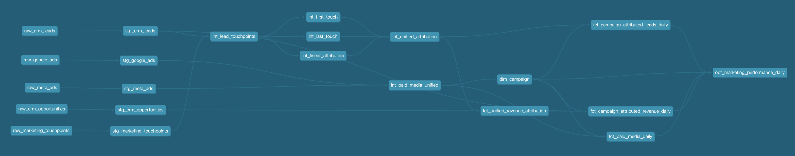

# Paid Media Analytics Mart | dbt + BigQuery

**Problem:** Marketing spend, leads, and revenue live in separate systems, making campaign-level reporting and attribution difficult to reconcile.

**Solution:** Built a dbt analytics mart in BigQuery combining Google Ads, Meta Ads, and CRM data into unified campaign performance reporting with first-touch, last-touch, and linear attribution.

Built with **synthetic data** for portfolio demonstration. No real company data.

## Architecture



The project follows a layered dbt architecture:

- **Staging:** Standardizes advertising, CRM, and marketing touchpoint data.
- **Intermediate:** Unifies paid media and calculates attribution weights.
- **Dimensions:** Defines consistent campaign and channel identifiers.
- **Facts:** Models advertising spend, attributed leads, and attributed revenue.
- **Final mart:** Combines performance metrics into a reporting-ready table.

The final reporting table combines spend, impressions, clicks, attributed leads, and closed-won revenue at the **date × campaign × attribution model** grain.

## Key Modeling Decisions

| Decision | Why it matters |
|---|---|
| Composite campaign key | Prevents campaign ID collisions across platforms |
| Explicit model grains | Prevents duplicate metrics from joins |
| First, last, and linear attribution | Supports comparison of credit assignment methods |
| Lead creation cohorts | Aligns attributed leads and revenue to acquisition date |
| Full outer joins | Preserves attributed activity without matching spend |

Spend remains on its actual advertising date and is repeated across attribution models. Reports must filter to one attribution model before summing spend.

## Data Quality

**75/75 dbt build steps passed:** 18 models, 52 tests, and 5 seeds.

Tests cover uniqueness, not-null constraints, relationships, attribution weights, and spend, lead, and revenue reconciliation.

During development, reconciliation tests caught missing attributed leads in the final mart. Updating the join logic resolved the discrepancy.

## Limitations

- Synthetic CSV seeds instead of live platform integrations.
- Rule-based attribution measures assigned credit, not causal incrementality.
- No production orchestration or incremental processing.

## Run It

Requires dbt Core, dbt-bigquery, and configured BigQuery credentials.

```bash
dbt deps
dbt seed
dbt build
```

To explore model documentation and lineage:

```bash
dbt docs generate
dbt docs serve
```