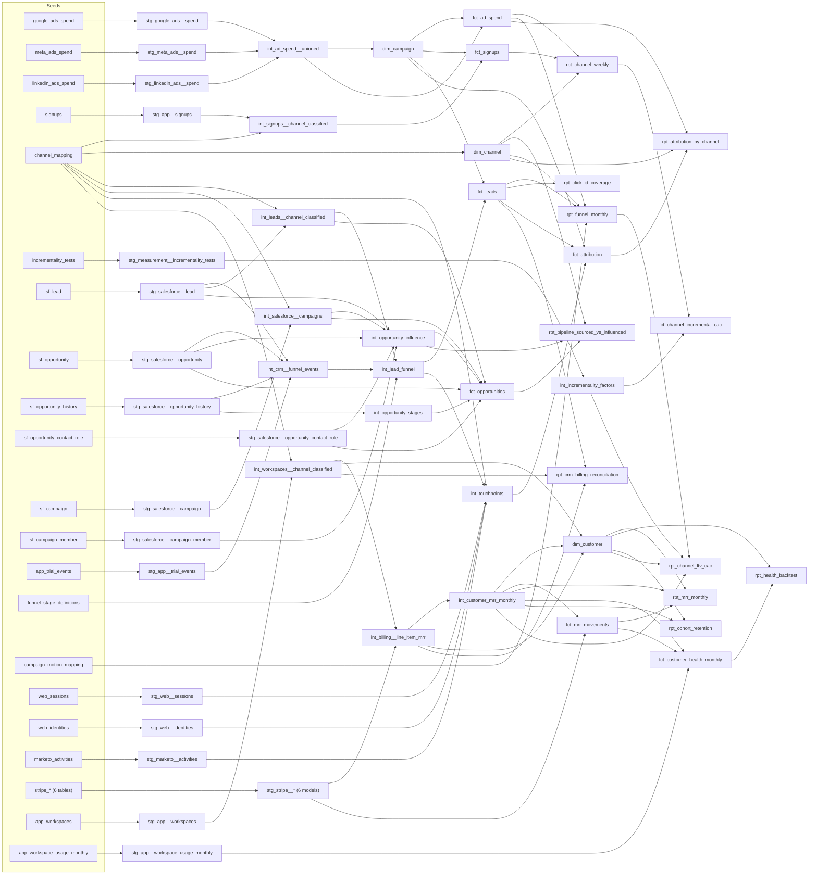

# Paid Media Performance Mart

A dbt + BigQuery project that unifies ad spend from Google Ads, Meta, and LinkedIn with
UTM-attributed signups in a star schema, and reports CAC and ROAS by channel and week. Later layers
follow the customer from first touch through Salesforce pipeline to billing: MRR, net revenue
retention, a usage-based health score, and lifetime value by acquisition channel.

Data is synthetic (generated by `scripts/generate_seeds.py`), built to mimic real platform
exports: different column names per platform, Google spend in micros, and messy UTMs.

**Start here:** [budget memo](docs/memo.md), a one-page recommendation for sales-led spend that
combines multi-touch attribution with incrementality test results. Analysis in
[`analysis/attribution_memo.ipynb`](analysis/attribution_memo.ipynb), which imports into Hex.

## Architecture



| Layer | Materialization | Purpose |
|---|---|---|
| Staging | view | One model per source: rename, cast, convert units. No joins. |
| Intermediate | view | Union the platforms; classify leads, signups, campaigns, and workspaces by channel; assemble the funnel from Salesforce objects; normalize invoices to monthly MRR. |
| Marts | table | Star schema plus a reporting model. |

## Star schema

| Model | Grain | Keys |
|---|---|---|
| `dim_channel` | one row per channel | `channel_key` |
| `dim_campaign` | one row per platform campaign | `campaign_key`, FK `channel_key` |
| `fct_ad_spend` | date x campaign | FKs `campaign_key`, `channel_key` |
| `fct_signups` | one row per signup | FKs `channel_key`, `campaign_key` (null for non-paid) |
| `rpt_channel_weekly` | week x channel | spend, signups, revenue, CAC, ROAS |
| `int_incrementality_factors` | one row per test | factor, confidence range, validity window |
| `fct_channel_incremental_cac` | week x paid channel | attributed vs. incremental signups and CAC |
| `fct_leads` | one row per lead | motion, product line, segment, stage timestamps, pipeline, won ARR |
| `rpt_funnel_monthly` | cohort month x product line x motion x channel | spend, stage counts, cost per lead / qualified / won, cost per pipeline dollar |
| `rpt_click_id_coverage` | entry form | share of paid search leads carrying a click ID |
| `fct_attribution` | one row per touch in a lead's journey | credit under first-touch, last-touch, linear, and position-based models |
| `rpt_attribution_by_channel` | attribution model x channel | attributed leads, opportunities, pipeline, won ARR, spend, pipeline per spend dollar |
| `fct_opportunities` | one row per opportunity | stage timestamps, days in each stage, sourced channel and campaign, buying committee size |
| `rpt_pipeline_sourced_vs_influenced` | product line x channel | sourced vs. influenced opportunities, pipeline, and won ARR |
| `dim_customer` | one row per paying workspace | motion, acquisition channel, first and current MRR, CRM link |
| `fct_mrr_movements` | customer x month | beginning and ending MRR, movement type, expansion driver, churn type |
| `rpt_mrr_monthly` | month x motion | MRR bridge, quick ratio, 12-month NRR and GRR (with numerators and denominators) |
| `fct_customer_health_monthly` | customer x month | usage, health score and band, churn in the next 3 months |
| `rpt_health_backtest` | sample x motion x health band | churn rates by band, calibration vs. holdout |
| `rpt_cohort_retention` | cohort quarter x motion x channel x month | logo and net MRR retention |
| `rpt_channel_ltv_cac` | motion x channel | CAC, incremental CAC, 12-month value, payback |
| `rpt_crm_billing_reconciliation` | one row per won lead | CRM won ARR vs. first-invoice ARR, reconciliation status |

## Design decisions

- **Surrogate keys** (`dbt_utils.generate_surrogate_key`) so campaign IDs from different
  platforms can never collide, and dims can be rebuilt without breaking facts.
- **Channel classification lives in a mapping seed**, not hard-coded CASE logic, so a new
  UTM variant is a one-row change.
- **UTM cleanup happens in staging** (lowercase, trim, blank to `(none)`) so the mapping join
  is exact.
- **`ad_platform` on signups** lets paid signups join to `dim_campaign` on
  (platform, campaign_id); signups with broken campaign tagging keep their channel but have
  no campaign.

## Tests (243)

- `unique` / `not_null` on every dimension key
- Fact grain: `unique_combination_of_columns(spend_date, campaign_key)`
- `relationships` from every fact and dim foreign key to its parent
- `accepted_values` on channel names
- **Spend reconciliation:** modeled spend must match the sum of the raw platform exports
  within $0.01
- **No unclassified signups:** fails if any UTM combination falls through to `Other`
- No negative spend
- **Funnel:** stages must happen in order, every event must be a valid stage for its lead's motion, and every campaign with spend must map to a motion
- **Attribution:** credits sum to 1 per lead under every model, every lead has exactly one
  lead-creation touch, no credited touch happens after the journey ends, and last-touch
  results reconcile exactly to the lead counts in `fct_leads`
- **Salesforce:** every converted lead points at a live opportunity and every opportunity has
  one converting lead, stage history is in order, sourced pipeline reconciles to `fct_leads` by
  channel, and every channel's influenced pipeline covers its sourced pipeline
- **Incrementality:** unique test IDs, factors between 0 and 2, test channels must exist in `dim_channel`, and no two tests on a channel can cover the same week
- **Revenue:** MRR movements roll forward exactly for every customer-month, the monthly bridge has no gaps,
  every completed invoice line is recognized in full across its service period, GRR stays between 0 and
  100% with NRR at or above it, every CRM trial conversion has a paying workspace, CRM-linked customers land
  in the same channel as their lead, no customer is billed before its workspace exists, and churn outcomes
  are null only where they can't be observed yet

## Incrementality calibration

UTM attribution says which channel touched a signup, not which channel caused it. This layer
adjusts attributed numbers with results from incrementality tests, following the method in the
[measurement playbook](https://github.com/tcmiyamoto/geo-incrementality/blob/main/playbook.md).

1. **Test registry** (`seeds/incrementality_tests.csv`): one row per test, with incremental
   conversions from the test and attributed conversions over the same period.
2. **Factors** (`int_incrementality_factors`): factor = incremental / attributed. Each factor
   applies from its test's end date until the next test on that channel ends.
3. **Incremental CAC** (`fct_channel_incremental_cac`): weekly attributed signups x the factor
   valid that week, with a range from the test's confidence interval. Each row is flagged
   `current`, `stale` (past its re-test date), or `untested` (incremental columns left null,
   not guessed).

| Channel | Spend | Attributed CAC | Incremental CAC | Factor | Status |
|---|---:|---:|---:|---:|---|
| Paid Search | $168,847 | $112 | $173 | 0.65 | current |
| Paid Social - Meta | $106,705 | $119 | $358 | 0.33 | current |
| Paid Social - LinkedIn | $76,058 | $277 | $346 | 0.80 | stale |

On attribution, Meta looks nearly as efficient as Paid Search. On an incremental basis it costs
about twice as much per signup, which points budget toward search and makes LinkedIn's
overdue re-test the next priority.

**Caveats.** Test results are illustrative; the Meta row matches the simulated geo test in
[geo-incrementality](https://github.com/tcmiyamoto/geo-incrementality). In production, the
registry's attributed conversions must use the same attribution source the factor is applied to
(here, UTM last touch), or the factor is miscalibrated.

## B2B funnel: PLG and SLG motions

A lead-level layer for a business with two product lines and two go-to-market motions:

| Product line | Motion | Entry form | Stages |
|---|---|---|---|
| Core | PLG | Free trial | trial started, activated (PQL), converted to paid |
| Core | SLG | Talk to sales | lead, meeting booked, meeting held (SQL), opportunity, won / lost |
| New product | SLG only | Working session | same SLG stages, longer cycle, larger deals |

**Design decisions**

- **One standard funnel across motions.** `funnel_stage_definitions` maps motion-specific
  stages (activated, meeting_held) to standard stages (qualified), so PLG and SLG report side
  by side without hiding that a PQL and an SQL are different things.
- **Spend splits by campaign landing form, not by allocation.** `campaign_motion_mapping`
  assigns each campaign to the motion its landing page feeds, so cost per stage by motion uses
  actual spend. A test fails if any campaign with spend is unmapped.
- **Cohort view.** `rpt_funnel_monthly` counts every stage against the month the lead was
  created, so conversion rates compare like with like. Recent cohorts are still open
  pipeline, especially for the longer new-product cycle.
- **Click ID coverage as a tracking check.** `rpt_click_id_coverage` shows the free trial form
  carries no Google click ID while the sales form does, so trial outcomes can't be sent back to
  the ad platform for bidding. This is a common gap when self-serve and sales-led flows are
  instrumented separately.
- **Portable SQL.** Funnel models use dbt cross-database macros (`dbt.date_trunc`,
  `dbt.datediff`, `dbt.type_string`) so they also run on Snowflake.

**Results (Jul 1 to Sep 30, 2026, cohorts still maturing)**

| Product line | Motion | Spend | Leads | Qualified | Won | Cost per qualified | CAC | Cost per pipeline $ |
|---|---|---:|---:|---:|---:|---:|---:|---:|
| Core | PLG | $215,325 | 3,352 | 1,487 | 474 | $145 | $454 | n/a |
| Core | SLG | $69,825 | 774 | 327 | 30 | $214 | $2,328 | $0.013 |
| New product | SLG | $66,460 | 202 | 97 | 4 | $685 | $16,615 | $0.019 |

Lead counts include organic, direct, referral, and email; spend is paid only. SLG CAC is
overstated until open opportunities close, which is why cost per pipeline dollar is the
better early read for sales-led spend.

Lead and stage data come from Salesforce objects and product trial events (see the next
section). `scripts/generate_salesforce_seeds.py` reads the ad spend seeds so lead volume follows
each campaign's daily spend.

## Salesforce CRM layer

The funnel and attribution layers read from Salesforce the way the Fivetran Salesforce connector
lands it: one table per object, snake_case standard fields, custom fields ending in `__c`, and
soft deletes in `is_deleted`. Free trial stages come from the product database, since trials
aren't a Salesforce object.

| Seed | Salesforce object | Used for |
|---|---|---|
| `sf_lead` | Lead | Every form fill and trial signup: UTMs, click ID, meeting dates, conversion IDs |
| `sf_account`, `sf_contact` | Account, Contact | Created when a sales-led lead converts |
| `sf_opportunity` | Opportunity | Amount, stage, close date, Primary Campaign Source (`campaign_id`) |
| `sf_opportunity_history` | OpportunityHistory | One row per stage change, for velocity and close timestamps |
| `sf_opportunity_contact_role` | OpportunityContactRole | The buying committee on each deal |
| `sf_campaign`, `sf_campaign_member` | Campaign, CampaignMember | Ad campaigns, inbound sources, and Marketo programs, and who responded |
| `app_trial_events` | (product database) | Trial started, activated, converted to paid |

**Design decisions**

- **The funnel is assembled, not exported.** `int_crm__funnel_events` builds each lead's stage
  events from where each stage actually lives: meeting dates on the Lead, the converted
  Opportunity, the first Closed stage in OpportunityHistory, and trial events from the product.
  It keeps the stage names `funnel_stage_definitions` already maps, so `fct_leads`,
  `fct_attribution`, and the LookML explores didn't change. The three existing reports
  (`rpt_funnel_monthly`, `rpt_attribution_by_channel`, `rpt_click_id_coverage`) produce
  identical output on the new sources.
- **Soft deletes filter in staging.** 67 merged duplicate leads (`is_deleted`, with
  `master_record_id` pointing at the surviving lead) and 3 deleted test opportunities never
  reach the marts.
- **PII stays in staging.** Lead and contact emails are hashed (`email_hash`) and the raw value
  dropped, so nothing downstream exposes them. Production would use a salted SHA-256.
- **Campaigns classify through the same channel mapping.** Each Salesforce campaign carries its
  canonical UTM source and medium, so a campaign, a lead, and a web session from the same source
  always land in the same channel. Ad campaigns link to `dim_campaign` for spend.

**Sourced vs. influenced pipeline** (`rpt_pipeline_sourced_vs_influenced`)

| Definition | Rule | Adds up to total? |
|---|---|---|
| Sourced | Channel of the opportunity's Primary Campaign Source (the converting lead's form fill) | Yes |
| Influenced | Any channel with a campaign response from anyone on the deal, converting lead or buying committee, in the 90 days before the opportunity opened | No: one deal counts for every channel that touched it |

Results (opportunities created Jul 1 to Sep 30, 2026; $9.14M pipeline):

| Channel | Sourced opps | Sourced pipeline | Share | Influenced opps | Influenced pipeline | Share | Multiplier |
|---|---:|---:|---:|---:|---:|---:|---:|
| Direct | 82 | $3.27M | 35.7% | 82 | $3.27M | 35.7% | 1.0x |
| Paid Social - LinkedIn | 29 | $2.26M | 24.7% | 76 | $3.96M | 43.3% | 1.8x |
| Organic Search | 39 | $1.38M | 15.1% | 39 | $1.38M | 15.1% | 1.0x |
| Paid Search | 50 | $0.99M | 10.8% | 57 | $1.21M | 13.2% | 1.2x |
| Email | 17 | $0.59M | 6.4% | 178 | $6.66M | 72.8% | 11.3x |
| Paid Social - Meta | 10 | $0.46M | 5.1% | 10 | $0.46M | 5.1% | 1.0x |
| Referral | 15 | $0.20M | 2.2% | 34 | $0.60M | 6.5% | 3.0x |
| Events | 0 | $0 | 0% | 101 | $4.55M | 49.7% | n/a |

- **Webinars source nothing and touch half the pipeline.** No deal starts at a webinar, but 101
  of 242 opportunities had someone attend one first, often a colleague of the person who
  converted. A sourced-only view would cut the program.
- **The buying committee is invisible to lead-level attribution.** 117 opportunity-channel pairs
  were touched only by committee contacts, not the converting lead. `fct_attribution` follows
  one person's journey; contact roles are how these touches show up.
- **Influenced inflates always-on channels.** Email's 11x multiplier reflects nurture volume (the
  same pattern linear attribution shows), so influenced is a presence metric, not a budget
  input. Sourced sets channel budgets; influenced flags programs whose value sourced misses,
  which then need an incrementality test before money moves.
- Sourced pipeline by channel matches last-touch pipeline in `fct_attribution` exactly (tested),
  since the Primary Campaign Source is the converting form fill.

**Stage velocity** (`fct_opportunities`; average days in each stage, completed stages only)

| Product line | Opps | Committee size | Discovery | Evaluation | Proposal | Negotiation | Days to close (won) | Win rate (closed) |
|---|---:|---:|---:|---:|---:|---:|---:|---:|
| Core | 196 | 2.3 | 13.1 | 9.6 | 8.4 | 10.3 | 33.7 | 25% of 119 |
| New product | 46 | 3.2 | 19.7 | 13.7 | 9.3 | 13.0 | 48.3 | 36% of 11 |

New product deals have bigger committees and a longer cycle. Most are still open at the end of
September, so its win rate rests on 11 closed deals and shouldn't be read yet.

**Caveats.** Data is synthetic. Buying committee engagement is generated to show the
sourced/influenced gap; in production it depends on how consistently sales adds contact roles,
which is worth checking before trusting influenced numbers. About 15% of committee campaign
responses happen after the opportunity opened and are excluded by the window.

## Multi-touch attribution

The funnel layer gives each lead one channel: the UTMs on the form it submitted. B2B buyers
usually touch several channels first, so that view hides what starts a journey. This layer
stitches every touch to a lead and compares four ways of crediting leads, pipeline, and won ARR.

**Sources** (generated by `scripts/generate_touchpoint_seeds.py`)

| Source | Shaped like | What it adds |
|---|---|---|
| `web_sessions` | GA4 session export | Visits with UTMs, including visitors who never convert |
| `web_identities` | Identity stitching | Links a browser's visitor ID to a lead when they submit a form |
| `marketo_activities` | Marketo activity log | Nurture email clicks and webinar attendance |

**Journey rules** (`int_touchpoints`)

- **The CRM form fill is always the lead-creation touch.** Every lead has one, even when web
  tracking was blocked. The web session in the 30 minutes before the form fill is the same
  visit, so it is dropped rather than counted twice.
- **Attribution window:** 90 days before the lead was created, through the opportunity for SLG
  leads that reached one, or through lead creation for everyone else. Post-trial onboarding
  emails and touches after an opportunity opens don't get credit.
- Marketo channels classify through the same `channel_mapping` seed as UTMs, which added an
  `Events` channel for webinars.

**Models** (`fct_attribution`, one row per touch; credits sum to 1 per lead)

| Model | Rule |
|---|---|
| Last touch | 100% to the lead-creation touch. Reconciles exactly to `fct_leads` (tested). |
| First touch | 100% to the earliest touch |
| Linear | Equal share to every touch |
| Position-based | W-shaped for leads with an opportunity (30% first, 30% lead creation, 30% last touch before the opportunity, 10% across the rest); U-shaped (40 / 40 / 20) otherwise |

**Data quality handled in the models**

- 22,513 sessions, 8,710 stitched to a lead. The rest are visitors who never converted or
  visits on a second device that was never identified.
- 347 leads (8%) have no web identity, so their journey is the form fill only.
- 99 duplicate Marketo rows removed (5,442 raw to 5,343).
- UTM casing variants (`LinkedIn`, `Google `) cleaned in staging.
- 5,478 touches outside the attribution window excluded.
- Retargeting campaigns never start a journey in the generated data, since they only reach
  past visitors. They show up as a first touch only when the earlier visit was on an
  untracked device (40 leads).

**Results: paid channels (Jul 1 to Sep 30, 2026)**

| Channel | Model | Leads | Opps | Pipeline | Share of pipeline | Pipeline per $ |
|---|---|---:|---:|---:|---:|---:|
| Paid Search | Last touch | 1,476 | 50 | $986K | 10.8% | $5.84 |
| | Position-based | 1,172 | 24 | $446K | 4.9% | $2.64 |
| Paid Social - LinkedIn | Last touch | 138 | 29 | $2.26M | 24.7% | $29.73 |
| | First touch | 288 | 73 | $3.10M | 33.9% | $40.71 |
| | Position-based | 217 | 44 | $2.16M | 23.7% | $28.45 |
| Paid Social - Meta | Last touch | 985 | 10 | $462K | 5.1% | $4.33 |
| | Position-based | 1,008 | 10 | $394K | 4.3% | $3.69 |

**What it says**

- **LinkedIn starts more journeys than it gets credit for.** It is the first touch on twice as
  many leads as it converts (288 vs. 138). 70% of LinkedIn-started leads filled in the form
  through another channel, mostly Direct (26%), Paid Search (15%), and Organic Search (15%),
  so last touch undervalues it as a source of new pipeline.
- **Last touch overstates Paid Search for pipeline.** 74% of the opportunities that converted
  through Paid Search started on another channel, most often LinkedIn (28%) or Organic Search
  (16%). Its pipeline share falls by more than half under the position-based model.
- **Linear rewards volume.** It gives Email 28% of pipeline because nurture emails are frequent,
  not because they open opportunities. Position-based (22%) is the better default for budget
  decisions, with first and last touch kept for channel-level questions.
- **Next step:** attribution shows where credit goes, not what would happen without the spend.
  Before moving budget to LinkedIn, rerun its lift test, which is already flagged `stale` in
  the incrementality layer.

**Caveats.** Data is synthetic and built to show these patterns. The 90-day lookback reaches
into May and June, before the spend data starts, so pipeline per dollar is slightly overstated
for channels with early touches. Pipeline per dollar also mixes PLG campaigns, which create no
pipeline, with SLG campaigns; slice `fct_attribution` by motion for a cleaner read.

## Revenue retention: CRM + billing + product usage

The layers above stop at the closed-won deal or the trial conversion. This layer follows customers after
they pay: MRR movements, net and gross revenue retention, a usage-based health score, and what each
acquisition channel's customers are worth. It joins three systems that don't share a key:

| Source | Shaped like | What it adds |
|---|---|---|
| `stripe_products`, `stripe_prices`, `stripe_customers`, `stripe_subscriptions`, `stripe_invoices`, `stripe_invoice_line_items` | Fivetran Stripe connector (amounts in cents) | What each customer is billed, for which service period, and why subscriptions ended |
| `app_workspaces` | Product database | The customer record: links a workspace to its Stripe customer, Salesforce lead or account, and signup UTMs |
| `app_workspace_usage_monthly` | Product database | Active users, active days, reports created, connected data sources |

Billing goes back to Oct 2024. Salesforce went live in July 2026, so 2,509 of 3,016 paying customers exist
only in billing and the product database (generated by `scripts/generate_billing_seeds.py`, which reads the
CRM seeds and never changes them).

**Design decisions**

- **The customer is the workspace, not the Salesforce account.** Most customers predate the CRM, and
  self-serve customers never get an account. `dim_customer` keys on the workspace, which carries the
  Stripe and Salesforce IDs. Tests check that every trial conversion in the CRM has a paying workspace and
  that a customer linked to a lead lands in the same channel as the lead.
- **MRR is a month-end snapshot of normalized line items.** Each recurring line's net amount is divided by
  the months in its service period, so an annual invoice counts as 1/12 a month for 12 months instead of a
  spike in the month it was billed. A test confirms every completed line is counted in exactly as many
  months as it covers, so annual contracts add up to their full amount.
- **What isn't MRR, and why:** void invoices (204 voided and reissued, which would double count),
  uncollectible renewals (115 failed payments), proration lines (467 one-off true-ups for mid-cycle plan
  changes; the new price counts from the next period), and 4 internal QA customers.
- **Motion comes from billing.** Sales-led contracts bill on a one-off quote price, self-serve customers on
  list prices, so motion is known for customers the CRM never saw.
- **Every movement has one type and a driver.** `fct_mrr_movements` classifies each customer-month as new,
  expansion, contraction, churn, reactivation, or flat, and tests that
  beginning + new + reactivation + expansion - contraction - churned = ending. Expansion is split into
  cross-sell, tier change, and price; churn is involuntary when the renewal invoice went uncollectible.
- **Rates are stored as numerators and denominators.** `rpt_mrr_monthly` keeps both, so NRR across motions is
  a sum over a sum, never an average of two percentages.
- **CRM and billing are reconciled, not assumed equal.** `rpt_crm_billing_reconciliation` compares won ARR
  in Salesforce to the first invoice for every deal and conversion in the quarter.

**Results: September 2026**

| Motion | MRR | Customers | NRR (12 mo) | GRR (12 mo) | Customers 12 mo ago still paying |
|---|---:|---:|---:|---:|---:|
| Self-serve (PLG) | $1.36M | 2,065 | 88.7% | 68.6% | 622 of 945 |
| Sales-led (SLG) | $0.50M | 180 | 118.4% | 87.7% | 58 of 66 |
| **Total** | **$1.86M** | **2,245** | **95.5%** | **73.0%** | **680 of 1,011** |

Trailing 12 months (Oct 2025 to Sep 2026): $1.20M new MRR, $297K expansion, $48K contraction, $299K churn.

| Expansion driver | PLG | SLG | Total | Share |
|---|---:|---:|---:|---:|
| Tier upgrade | $179K | $0 | $179K | 60% |
| New product cross-sell | $18K | $61K | $80K | 27% |
| Price (renewal uplift, coupon ending) | $24K | $15K | $38K | 13% |

**What it says**

- **Net retention is below 100% because self-serve leaks logos, not because customers shrink.** Sales-led
  accounts grow 18% a year net. Self-serve loses about 3% of customers a month, and upgrades only recover
  part of it. The lever is self-serve churn, not more upsell.
- **22% of self-serve churned MRR is failed payments** ($62K of $281K). The health score can't see it
  (below), so it belongs to billing (card retries, dunning emails, card updater), not customer success.
- **Cross-sell already drives 27% of expansion, nine months after the new product launched,** mostly through
  sales-led accounts. It is the main reason SLG NRR is above 115%.
- **All self-serve "price" expansion is coupons ending.** MRR is net of discounts, so a 50%-off promo rolling
  off looks like upsell. Promo-acquired Meta customers drop from 86% to 71% retained in month 3, the month the
  coupon ends, against 90% to 82% for full-price Meta customers. The driver split keeps this from being
  reported as growth.
- **CRM overstates new self-serve ARR by 6%.** Salesforce books list price; 87 conversions chose the annual
  plan (20% off) and 39 used a coupon. Of 34 sales-led deals, 31 match billing to the cent, 2 were invoiced
  below the Salesforce amount (a year-one ramp and an extra discount agreed after close), and the deal that
  closed on Sep 30 isn't invoiced yet. Those three go to RevOps.

**Health score** (`fct_customer_health_monthly`): usage only, 0 to 100, banded healthy (70+), watch (40-69), at
risk (under 40). Weights were set from churn rates by component on Oct 2024 to Dec 2025 customer-months and
checked on Jan to Jun 2026, which they never saw.

| Self-serve, holdout (Jan to Jun 2026) | Customer-months | Churn in next 3 mo | Voluntary | Involuntary |
|---|---:|---:|---:|---:|
| Healthy | 5,516 | 6.3% | 4.8% | 1.5% |
| Watch | 1,924 | 12.1% | 10.7% | 1.4% |
| At risk | 1,773 | 17.9% | 16.7% | 1.2% |

- At-risk customers churn at 2.9x the rate of healthy ones (3.5x for voluntary churn). The at-risk band is 19%
  of customer-months and 35% of churn in the next quarter, which makes it a workable CSM queue.
- **The first version didn't work.** It gave 40 of 100 points to the active-user trend, which turned out to be
  the weakest signal: watch and at-risk churned at 14.5% and 16.4% in the holdout, too close to act on.
  Active days per user, connected data sources, and reports per user carried the signal, so they now carry
  85 of the 100 points. The trend keeps 15, lost only when active users fall below 70% of their prior
  three-month average.
- Involuntary churn is flat across bands, as it should be: usage doesn't predict an expired card.
- Sales-led churn is too rare to backtest (21 of 1,357 customer-months precede a churn), so the score is
  only validated for self-serve.

**Channel economics** (`rpt_channel_ltv_cac`, self-serve): CAC is Jul to Sep 2026 spend per paying customer.
Twelve-month value is gross profit (80% margin, a `gross_margin` var) per customer from cohorts that first
paid Oct 2024 to Sep 2025.

| Channel | Customers won | CAC | Incremental CAC | Logo retention, month 12 | 12-mo gross profit | 12-mo value / CAC | 12-mo value / incremental CAC | Payback (incremental) |
|---|---:|---:|---:|---:|---:|---:|---:|---:|
| Paid Search | 191 | $644 | $991 | 60% | $4,508 | 7.0x | 4.6x | 3 months |
| Paid Social - Meta | 115 | $803 | $2,404 | 56% | $4,417 | 5.5x | 1.8x | 7 months |
| Organic Search | 78 | n/a | n/a | 75% | $4,579 | n/a | n/a | n/a |
| Referral | 18 | n/a | n/a | 67% | $6,188 | n/a | n/a | n/a |

- Meta customers keep slightly fewer logos, but the survivors are worth about the same over a year. The
  retention gap is small; the incrementality gap is large. On attributed CAC, Meta returns 5.5x in a year.
  On incremental CAC it returns 1.8x and takes 7 months to pay back, against 3 for Paid Search. That is the
  same direction as the incrementality and attribution layers, now in dollars of lifetime value.
- Organic and referral customers retain best (75% and 67% of logos at month 12). Organic customers also
  expand (106% net MRR retention at month 12) and referral customers start on bigger plans, a case for
  investing in both that CAC alone can't make, since neither has spend.
- Sales-led channel economics aren't shown: 34 deals closed in the quarter, LinkedIn's pipeline is mostly
  still open, and cost per pipeline dollar (above) is the better early read.

**Caveats.** Data is synthetic and generated to show these patterns. Valuing today's customers with 2024-25
cohorts assumes retention hasn't changed. Incremental CAC applies factors measured on signups to paying
customers. NRR and GRR use a month-end snapshot, so a customer who churns and returns within the same month
never shows up as churned.

## Semantic layer (LookML)

`lookml/` defines the Looker layer over the marts: three explores, six views, and project
constants for the BigQuery project and dataset. The code is written and checked but not
deployed, since this project has no Looker instance.

| Explore | Base view | What it answers |
|---|---|---|
| `attribution` | `fct_attribution` | Leads, pipeline, and won ARR by channel or campaign under any attribution model |
| `lead_funnel` | `fct_leads` | Single-touch funnel and conversion rates by product line, motion, channel, and campaign |
| `pipeline` | `fct_opportunities` | Sourced pipeline, win rate, and stage velocity by product line, segment, channel, and campaign |

**Design decisions**

- **One set of measures, any attribution model.** An `attribution_model` parameter (unquoted)
  picks the credit column with Liquid, so `attributed_pipeline` and the other measures switch
  models from a single filter instead of needing four copies.
- **Spend can't fan out.** Spend is joined at channel grain to touch-level rows. The
  `channel_spend` view has a primary key, so Looker uses symmetric aggregates and counts each
  channel's spend once. Without it, LinkedIn's $76K spend would show as $57.9M: once per touch.
- **Spend ignores date filters** (noted in the field description), because a touch date filter
  on spend would mix two different periods.

**How it was checked.** All files parse with the `lkml` parser, every `${field}` reference and
join resolves, and the SQL Looker generates for the `attribution` explore (including the
symmetric-aggregate spend) was run against BigQuery. It matches `rpt_attribution_by_channel`
exactly. For example, LinkedIn under first touch: 288 leads, $3.10M pipeline, $40.71 pipeline
per spend dollar.

## Results (Jul 1 to Sep 30, 2026)

| Channel | Spend | Signups | CAC |
|---|---:|---:|---:|
| Paid Search | $168,847 | 1,502 | $112 |
| Paid Social - Meta | $106,705 | 894 | $119 |
| Paid Social - LinkedIn | $76,058 | 275 | $277 |
| **Blended paid** | **$351,610** | **2,671** | **$132** |

ROAS uses first-month plan revenue only, so it understates lifetime return.

## CI/CD: slim CI with dbt state

Two GitHub Actions workflows keep production current and test pull requests cheaply.

| Workflow | Trigger | What it does |
|---|---|---|
| `dbt_prod.yml` | push to `main`, weekly | `dbt build` into the `dbt_prod` dataset, then saves `manifest.json` as an artifact |
| `dbt_ci.yml` | pull request | Downloads the latest production manifest and runs `dbt build --select state:modified+ --defer --state` into `dbt_ci` |

- **`state:modified+`** compares the PR's code to the production manifest and selects only
  changed models, seeds, and tests plus everything downstream. Changing `fct_attribution`
  runs 2 of 40 models and 13 of 156 tests.
- **`--defer`** reads unchanged upstream models from production instead of rebuilding them, so
  CI doesn't recompute the whole project to test one change.
- If no production manifest exists yet (first run, or the artifact expired), CI falls back to
  a full build. The weekly production run keeps the artifact from expiring.
- Credentials: a service account with BigQuery Data Editor and Job User roles, stored as the
  `GCP_SA_KEY` secret. `ci/profiles.yml` uses Application Default Credentials, so no key file is
  committed. Workload Identity Federation would remove the stored key entirely.

## Run it

```bash
python -m venv dbt-env && source dbt-env/bin/activate
pip install dbt-bigquery
dbt deps
python scripts/generate_seeds.py
python scripts/generate_salesforce_seeds.py
python scripts/generate_touchpoint_seeds.py
python scripts/generate_billing_seeds.py
dbt build          # seeds, models, and tests
dbt docs generate && dbt docs serve
```

Requires a BigQuery project and a `profiles.yml` using oauth.

## Lineage


