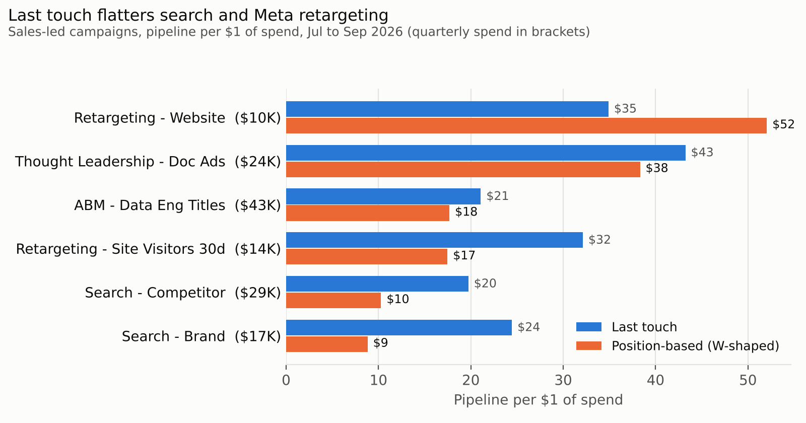
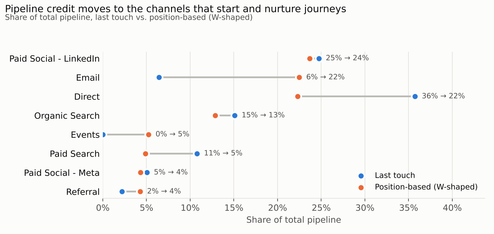
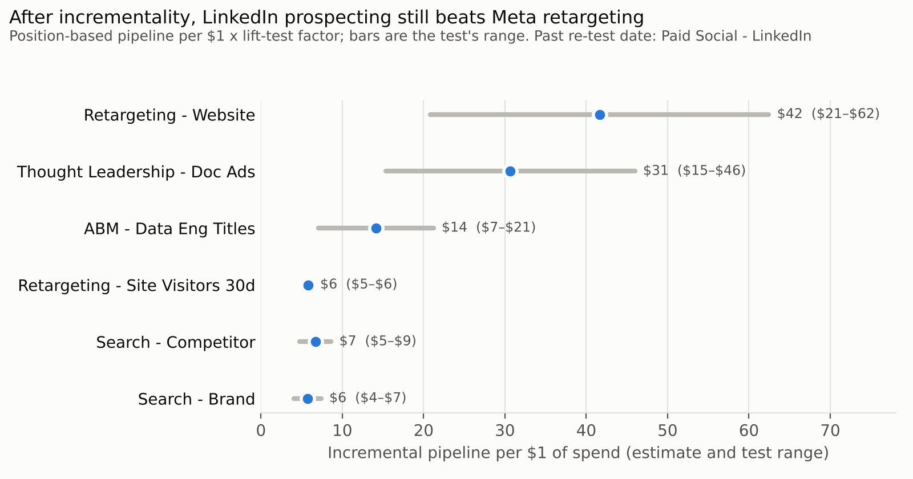

# Memo: rebalancing sales-led paid spend

**To:** Marketing leadership · **Period:** Jul 1 to Sep 30, 2026 · **Data:** synthetic, see [README](../README.md)
**Analysis:** [`analysis/attribution_memo.ipynb`](../analysis/attribution_memo.ipynb)

## Recommendation

1. **Move $7.2K a quarter (half of Meta Retargeting) to LinkedIn Thought Leadership Doc Ads.**
   Expected change: about **+$150K pipeline** a quarter on position-based attribution, or
   **+$65K to +$179K** after adjusting for incrementality. That's an upper bound, since it uses
   average returns and extra spend usually earns less than the average.
2. **Rerun the LinkedIn lift test this quarter, before moving the other half.** Its result is
   past its re-test date (May 15) and has the widest range of any channel (factor 0.40 to 1.20).
   Split prospecting and retargeting into separate test cells.
3. **Hold brand search flat and stop using last touch to justify it.** Last touch makes it look
   2.8x better than position-based does. Plan a brand holdout to measure what it adds.
4. **Report sales-led spend on position-based pipeline per dollar.** Keep last touch for
   form-conversion and bidding questions, where it is the right tool.

## Why

**Last touch flatters the campaigns that capture demand.** Brand search, competitor search, and
Meta retargeting reach people already looking for us. They get full credit for the form fill
under last touch and lose about half of it or more once the touches that started the journey count.

| Campaign | Spend | Last touch | Position-based | Change |
|---|---:|---:|---:|---:|
| Search - Brand | $17.3K | $24 | $9 | -64% |
| Search - Competitor | $28.5K | $20 | $10 | -48% |
| Meta Retargeting - Site Visitors 30d | $14.4K | $32 | $17 | -46% |
| LinkedIn ABM - Data Eng Titles | $42.8K | $21 | $18 | -16% |
| LinkedIn Thought Leadership - Doc Ads | $23.7K | $43 | $38 | -11% |
| LinkedIn Retargeting - Website | $9.6K | $35 | $52 | +49% |

*Pipeline per $1 of spend, sales-led campaigns.*

**Credit moves to the channels that start and nurture journeys.** Under position-based
attribution, Paid Search drops from 11% to 5% of pipeline. Email and Events gain, because nurture
touches often come right before an opportunity opens.

**Incrementality decides between the remaining options.** Multiplying each campaign's
position-based return by its channel's latest lift-test factor ranks LinkedIn prospecting well
above Meta Retargeting, even at the pessimistic end of LinkedIn's range ($15 vs. $6 per dollar).
That is why the move is safe to start before the re-test. The size of the second step depends on
the re-test.

## Why not LinkedIn Retargeting, the top campaign?

It has the highest return on every chart, but it only reaches people who already visited the
site. Its reach is capped by site traffic, and retargeting is usually much less incremental than
its channel's average, so the channel-level factor likely overstates it. Hold it until the
LinkedIn re-test measures retargeting on its own.

## Caveats

- **Data is synthetic**, generated to resemble a B2B SaaS funnel; the method is the point.
- **Lift-test factors are channel-level and measured on signups**, applied here to pipeline.
  Read the incremental figures as a ranking, not a forecast.
- **Recent cohorts are still open.** Pipeline is the early read; won ARR will lag by one to three
  months, longer for the new product.
- **The 90-day lookback reaches into May and June**, before spend data starts, so pipeline per
  dollar is slightly high for channels with early touches.
